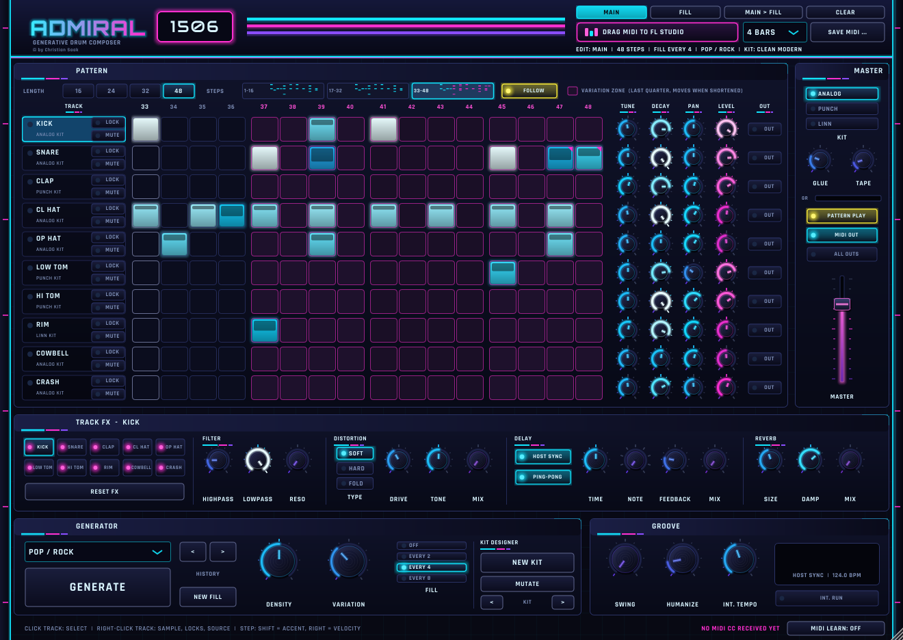

# CSSynth Admiral 1506 – Generativer Drumcomputer

**© by Christian Saak** · Teil der CSSynth-Familie (neben dem *Diplomat 1506*)



Admiral erzeugt auf Knopfdruck Drum-Pattern in sieben Genres, spielt sie mit eingebauten 80er-Kits ab
und gibt sie zusätzlich als MIDI aus – live an andere Instrumente oder per Drag & Drop direkt in FL Studio.

Formate: **VST3** und **Standalone** (Windows 10/11, x64) · **VST3, Audio Unit und Standalone** (macOS 11+, Apple Silicon + Intel).
Getestet ausgelegt für **FL Studio** und **Cubase**.

---

## Installation

### Windows – FL Studio
1. ZIP `Admiral-1506-Windows-x64.zip` entpacken.
2. `Install_VST3.bat` per Rechtsklick **„Als Administrator ausführen“**.
3. FL Studio: *Options › Manage plugins › Find installed plugins*. Admiral erscheint unter *Generators*.

### Windows – Cubase
1. ZIP entpacken, `Install_Cubase.bat` doppelklicken (fordert Administratorrechte selbst an).
2. Cubase: *Studio › VST-Plug-in-Manager › Aktualisieren*. Admiral erscheint unter *Instrumente › Drum*.

### macOS (Cubase, Logic, FL Studio für Mac …)
1. ZIP `Admiral-1506-macOS-Universal.zip` entpacken.
2. `Install_macOS.command` doppelklicken (falls macOS warnt: Rechtsklick › *Öffnen*).
   Kopiert VST3 und Audio Unit in `~/Library/Audio/Plug-Ins` und entfernt die Quarantäne-Markierung.
3. In der DAW die Plugin-Liste neu einlesen.

---

## Bedienung

| Bereich | Funktion |
|---|---|
| **GENERATOR** | Genre wählen, **GENERATE** drücken. `<` / `>` blättern durch die letzten 32 erzeugten Pattern. **NEW FILL** erzeugt nur den Fill-Takt neu. |
| **KIT DESIGNER** | **NEW KIT** würfelt ein neues Kit nach Regeln: das Genre bestimmt einen Charakter (*Dry & Tight, Big 80s Room, Lo-Fi, Industrial, Clean Modern*), daraus werden Kit-Mischung, Stimmung, Decay, Panorama, Filter, Effekte sowie GLUE/TAPE abgeleitet – mit automatischem Pegelausgleich. **MUTATE** variiert das aktuelle Kit nur leicht. `<` / `>` blättern durch die letzten 32 Kits (der Ausgangszustand bleibt erreichbar). Nie verändert: Mute, OUT, Master, Tempo, MIDI und eigene Samples. |
| DENSITY | wie viele der optionalen Schläge gespielt werden (wenig = minimal, viel = dicht, 16tel-Hats) |
| VARIATION | zusätzliche Zufallsschläge, Ghost-Notes, Anschlags-Streuung, längere Fills |
| FILL | Fill in jedem 2. / 4. / 8. Durchlauf des Patterns, danach automatisch ein Crash |
| **PATTERN** | 10 Spuren × bis zu **48 Schritte**. **LENGTH** 16 / 24 / 32 / 48. Das Raster zeigt 16 Schritte je Seite; die Seitenwahl (1-16, 17-32, 33-48) zeigt eine Mini-Vorschau des ganzen Patterns, **FOLLOW** blättert beim Abspielen mit. Klick: an/aus (Ziehen malt), **Shift-Klick**: Betonung, **Rechtsklick**: Anschlagstärke, **Mausrad**: fein |
| Variations-Zone | Der Generator erzeugt immer 48 Schritte (3 Takte, die sich leicht weiterentwickeln) und setzt hin und wieder eine kleine Variation ins **letzte Viertel** (magenta markiert, kleines Dreieck = weicht vom Groove ab). Kürzen auf 32 / 24 / 16 ist nicht zerstörend: die Variation wandert ans neue Ende, beim Verlängern ist alles wieder da. Rechtsklick in der Zone: Variation an einem Schritt oder ganz entfernen. |
| LOCK | sperrt Pattern **und** Sound der Spur. Per Rechtsklick getrennt: *Lock pattern* (bleibt bei GENERATE) und *Lock sound* (bleibt bei NEW KIT / MUTATE) – Anzeige dann LOCK P bzw. LOCK S |
| MUTE / OUT | Spur stumm / auf eigenen Ausgang legen |
| TUNE · DECAY · PAN · LEVEL | Stimmung (±12 Halbtöne), Ausklang, Panorama, Lautstärke je Spur |
| MAIN / FILL | normaler Durchlauf oder Fill-Durchlauf bearbeiten (die Fill-Zone ist die letzte Hälfte, höchstens 12 Schritte) |
| **TRACK FX** | Effekte der gewählten Spur (Spur im Raster oder in der Spurwahl anklicken): **Filter** (Highpass, Lowpass, Reso) › **Distortion** (Soft/Hard/Fold, Drive, Tone, Mix) › **Delay** (HOST SYNC, Time bzw. Notenwert, Feedback, Mix, Ping-Pong) › **Reverb** (Size, Damp, Mix). Spuren mit aktiven Effekten zeigen ein **FX**-Zeichen. RESET FX setzt die Spur zurück. |
| **GROOVE** | SWING (verschiebt jede zweite 16tel), HUMANIZE (leichte Zeit- und Anschlags-Streuung), INT. TEMPO / INT. RUN |
| **MASTER** | Kit (ANALOG = weich/808-artig, PUNCH = hart/909-artig, LINN = 80er-Sample-Drumcomputer mit 8-Bit-Korn), **GLUE** (Bus-Kompressor mit Sidechain-Hochpass, GR-Anzeige), **TAPE** (Band-Sättigung, antialiased), **ALL OUTS** (alle Spuren auf eigene Ausgänge), Master-Lautstärke. GLUE/TAPE wirken auf den Main-Ausgang. |

**Klang-Engine:** leise Schläge klingen automatisch dumpfer (Klangfarbe folgt der Anschlagstärke), jeder Schlag variiert minimal
in Tonhöhe und Klangfarbe (Round Robin, kein „Maschinengewehr“-Effekt), 4-Punkt-Interpolation beim Umstimmen.

**Spur anklicken** = auswählen und vorhören · **Rechtsklick › Sound source** = Klang einer Spur aus einem bestimmten Kit (z. B. Linn-Snare im Analog-Kit) · **Doppelklick / Rechtsklick › Load sample** = eigene Audiodatei
(WAV, AIFF, FLAC, OGG, MP3; max. 10 s) · Audiodatei **auf eine Spur ziehen** geht auch.
Eigene Samples werden im Projekt gespeichert.

### Wiedergabe
* **Im Host:** Admiral läuft synchron zum Transport der DAW (Tempo, Position, Loops).
* **Standalone / Host gestoppt:** **INT. RUN** einschalten, Tempo mit **INT. TEMPO**.

### MIDI
* **DRAG MIDI TO FL STUDIO** – Fläche anfassen und in die Piano Roll eines Instruments (z. B. FPC, oder Admiral selbst) oder in die Playlist ziehen.
  Länge (1, 2, 3, 4, 6, 8, 12 oder 16 Takte) im Feld daneben – 3 / 6 / 12 Takte passen genau zu Pattern mit 48 Schritten; das Pattern läuft darin fortlaufend in seiner eingestellten Länge, Variationen, Fills, Crash und Swing sind enthalten. **SAVE MIDI …** speichert als Datei.
* **PATTERN PLAY** (MASTER-Bereich) – aus: Admiral spielt sein internes Pattern nicht mehr und ist ein reines Klangmodul,
  das nur auf MIDI-Noten reagiert. So lässt sich ein exportiertes Pattern in der Piano Roll von Admiral weiterbearbeiten,
  ohne dass es doppelt spielt. Sounds, Effekte, Kit Designer und GLUE/TAPE bleiben voll wirksam.
* **MIDI OUT** – Noten (General MIDI, Kanal 10: Kick 36, Snare 38, Clap 39, Hats 42/46, Toms 45/50,
  Rim 37, Cowbell 56, Crash 49) gehen zusätzlich an den MIDI-Ausgang, z. B. für FPC oder Battery.
  FL Studio: im Plugin-Fenster *⚙ › MIDI › Output port* setzen und beim Ziel-Instrument denselben *Input port*.
* **MIDI-Eingang** – dieselben Noten spielen die Spuren (Pads des Oxygen 61 Pro).
* **MIDI LEARN** – Rechtsklick auf Regler/Taster oder Taster *MIDI LEARN* in der Fußzeile, dann Controller bewegen.

### Einzelausgänge (jeder Sound auf eine eigene Mixer-Spur)
Admiral hat 11 Stereo-Ausgänge: **1–2 Main**, danach je einer für Kick, Snare, Clap, CL Hat, OP Hat, Low Tom, Hi Tom, Rim, Cowbell, Crash.
Eine Spur mit **OUT** (oder alle mit **ALL OUTS**) vom Main-Ausgang auf ihren eigenen Ausgang legen. Die Spur-Effekte wandern mit.
* **FL Studio:** Plugin-Fenster › Zahnrad ⚙ › Reiter *Processing* bzw. im Bereich *Output* den Ausgängen Mixer-Spuren zuweisen
  (oder per Rechtsklick auf die Mixer-Spur-Nummer). Danach im Mixer pro Sound eigene Plugins/EQ verwenden.
* **Cubase:** Im Rack auf das Ausgangs-Symbol des Instruments klicken und die gewünschten Ausgänge aktivieren –
  jeder erscheint als eigener Mixer-Kanal. Nicht benötigte Ausgänge dort einfach deaktivieren.

---

## Selbst bauen

Push auf GitHub genügt: `.github/workflows/build.yml` baut Windows und macOS, führt die Selbsttests aus und stellt die
ZIPs als Artefakte bereit (bei einem Tag `v*` zusätzlich als Release).

Lokal (CMake ≥ 3.22, Visual Studio 2022 bzw. Xcode):

```
cmake -S . -B build -DADMIRAL_BUILD_TESTS=ON -DADMIRAL_BUILD_PLUGIN_TEST=ON
cmake --build build --config Release
```

JUCE 8.0.12 wird automatisch geladen (oder `-DADMIRAL_JUCE_DIR=<Pfad>`).

### Projektaufbau
```
Source/Core/        Generator, Sequencer, Sampler (ohne JUCE, getestet in tests/core_test.cpp)
Source/             Plugin (Processor, Oberfläche im Diplomat-Stil)
Resources/Kits/     eingebaute Kits – per Klangsynthese erzeugt mit tools/make_kits.py
Resources/Fonts/    Orbitron, Audiowide, Rajdhani (SIL Open Font License)
packaging/          Installationsskripte (FL Studio, Cubase, macOS)
```

Die Kit-Klänge sind vollständig synthetisch (Sinus, Rechteck, Rauschen, Filter) und enthalten keine fremden Samples.
Neu erzeugen: `python3 tools/make_kits.py Resources/Kits` (benötigt numpy und scipy).
